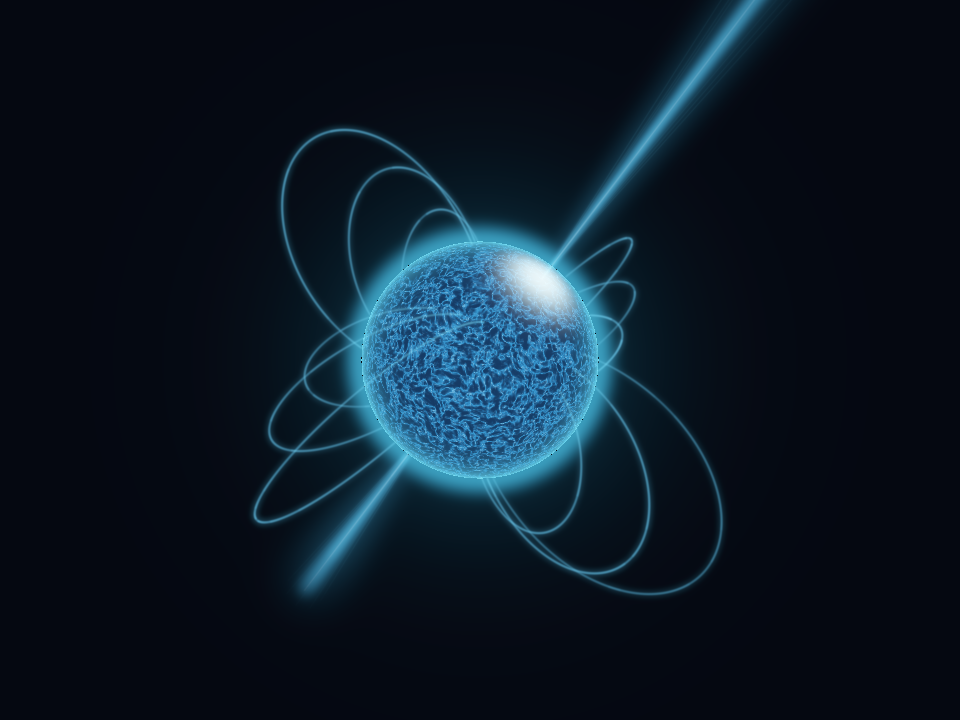
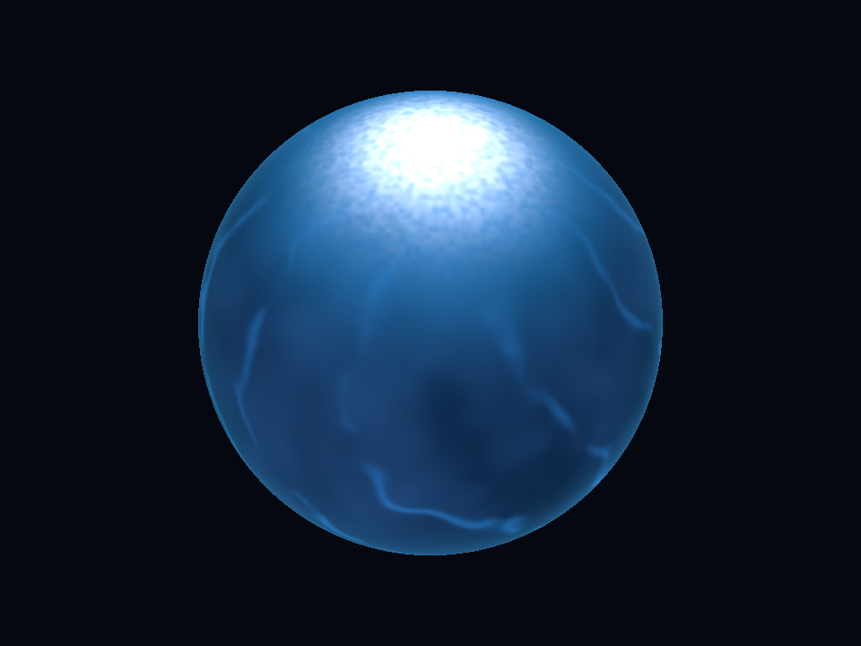
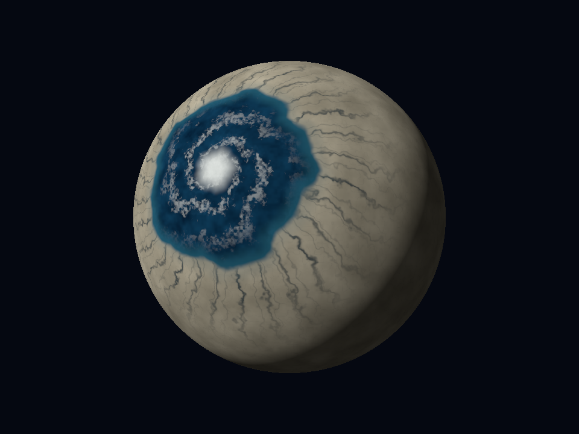
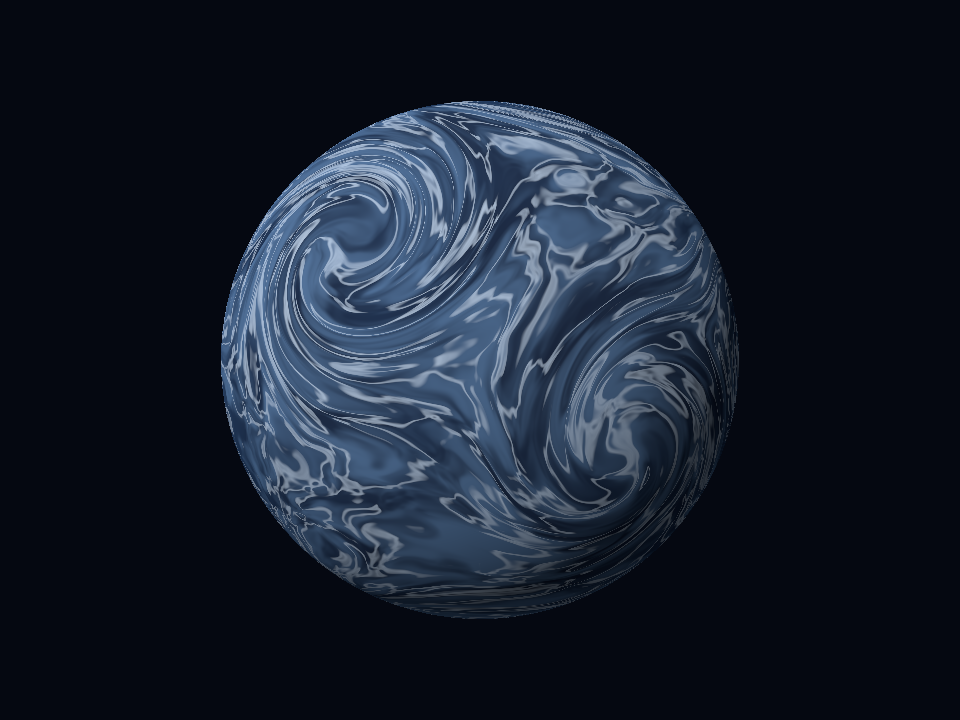
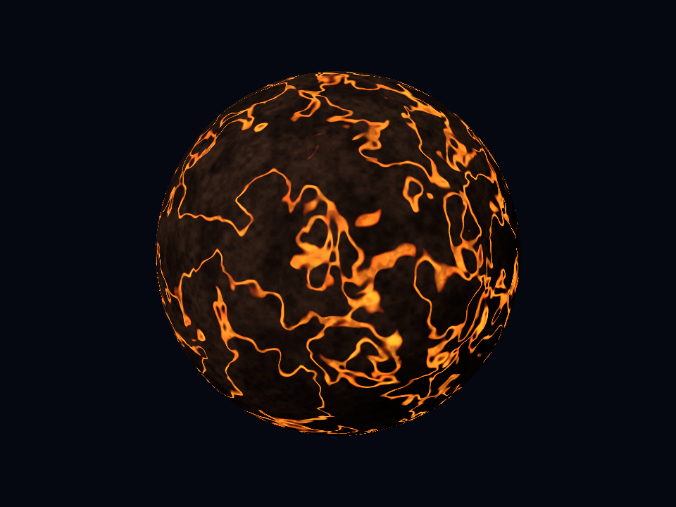
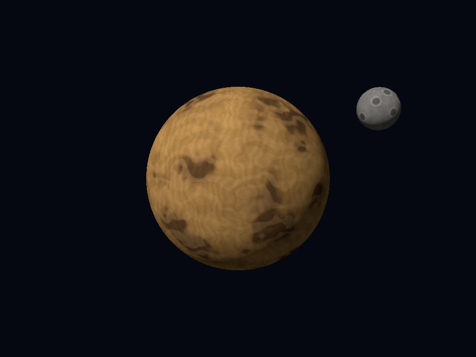
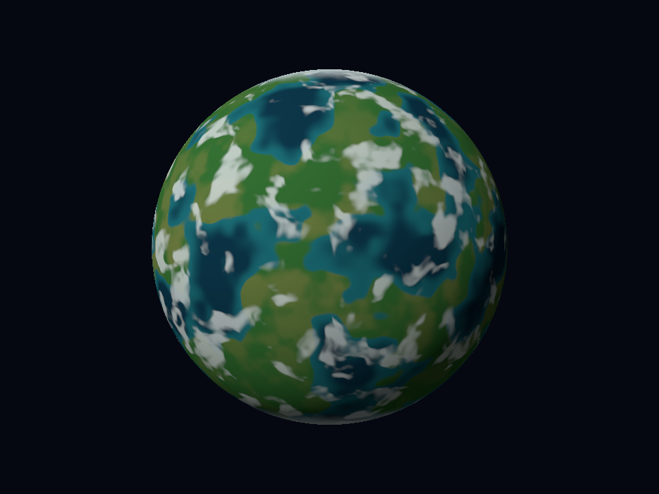

# lab5 — Cuerpos celestes con shaders procedurales

Laboratorio de gráficos por computadora: tres cuerpos celestes principales y tres planetas extra renderizados en **CPU**, con colores calculados por shaders sobre una esfera procedural. No se cargan texturas ni materiales de apariencia.

## Obtener el código

```sh
git clone https://github.com/SrCharlied/lab5.git
cd lab5
```

## Abrir toda la presentación con un solo comando

```sh
cargo run --release --locked
```

Abre un slideshow en una sola ventana, empezando por el púlsar. Recorre automáticamente siete vistas cada ocho segundos: púlsar, océano-ojo, gigante gaseoso, volcánico, desértico con luna, templado y estrella base. No hace falta cerrar la aplicación ni ejecutar otro comando para cambiar de cuerpo.

| Control del slideshow | Acción |
|---|---|
| Flecha izquierda / derecha | Vista anterior / siguiente; reinicia su espera de ocho segundos |
| Espacio | Pausar/reanudar avance automático y animación del púlsar |
| R | Volver al púlsar inicial y reanudar |
| P | Guardar exactamente el cuadro presentado |
| Esc | Salir |

Se puede cambiar de vista manualmente mientras está pausado. El título indica nombre, posición y estado. Los planetas y la luna siguen estáticos; el púlsar conserva su giro y pulso. Para una ventana más ligera puede añadirse `-- --width 640 --height 480` al comando.

[Detalles y verificación del slideshow](docs/slideshow.md).

## Modos individuales opcionales

Requiere **Rust 1.88 o superior**, Cargo y una sesión gráfica para abrir ventanas. La primera compilación descarga las dependencias fijadas en `Cargo.lock`.

Desde la carpeta del repositorio, ejecutar uno de estos comandos:

```sh
# Estrella principal: púlsar individual
cargo run --release --locked -- --pulsar --width 640 --height 480

# Estrella base — superficie estática conservada
cargo run --release --locked -- --neutron --angle -0.65

# Rocoso congelado con océano-ojo
cargo run --release --locked -- --eyeball

# Gigante gaseoso — diseño final turbulento
cargo run --release --locked -- --gas-v2
```

Los selectores explícitos abren vistas individuales con sus controles anteriores. Sin seleccionar un modo se abre el slideshow; `--slideshow` también lo selecciona. La estrella base sigue disponible con `--neutron`, y su variante animada con `--neutron-live`. `--diagnostic` abre el diagnóstico de normales. Las capturas del slideshow van a `renders/captures/`: `pulsar-main.png` para la primera vista y `slide-02.png` a `slide-07.png` para las demás, fuera de las referencias de entrega. `--output` permite elegir una ruta PNG explícita.

## 1. Estrella de neutrones — púlsar principal



Presentación principal elegida: superficie turbulenta, arcos magnéticos artísticos, haces y corona. Es una composición procedural de CPU; los efectos exteriores no se presentan como simples capas de color sobre la esfera. Para el requisito estricto de shader de superficie se conserva íntegra la estrella base:

### Versión base conservada — `--neutron`



Base azul profunda, dos regiones polares blanco-cian con granulación, filamentos curvos y borde frío interior. La región del polo lejano puede quedar oculta por la propia esfera.

## 2. Rocoso — interpretación artística de LHS 1140 b



Costra de hielo beige, fracturas, una única región de océano azul y un remolino nuboso. Es un diseño artístico de mundo congelado, no una reconstrucción observada de la superficie del exoplaneta.

## 3. Gigante gaseoso — interpretación artística de HD 189733 b



Masas nubosas azules, corrientes retorcidas distribuidas, filamentos pálidos y bruma. No utiliza la ilustración de referencia como textura ni pretende reproducir un mapa meteorológico observado.

## Tres planetas extra y luna

Ampliación aprobada visualmente. Son diseños propios inspirados en la variedad de las ilustraciones de TRAPPIST-1, no mapas observados ni una reproducción científica de sus planetas.

### Volcánico



Basalto oscuro y redes de lava emisiva; no es una recoloración de la estrella.

### Desértico con luna



Arena ocre, cuencas y estratos. La luna tiene su propia esfera, transformación y shader de cráteres por color; ambos cuerpos se rasterizan en el mismo framebuffer y z-buffer. No es un círculo 2D pegado ni parte del modelo del planeta.

### Templado



Océanos azul verdoso, continentes verdes, hielo polar y nubes fragmentadas. Su distribución global de continentes es distinta del océano-ojo.

```sh
cargo run --release --locked -- --volcanic
cargo run --release --locked -- --desert --moon
cargo run --release --locked -- --temperate
```

`--desert` permite ver el planeta sin su luna. Los tres extras admiten `--layers 1..4`, `--angle`, capturas sin ventana y las teclas P/Esc. Son estáticos: la luna no orbita. [Capas, ecuaciones y límites de los extras](docs/extras.md).

Se presentan tres planetas nuevos y una luna como criterios adicionales de la rúbrica; no se cuentan las variantes anteriores ni el púlsar como planetas nuevos y no se garantiza una nota.

## Capas y ecuaciones

La estrella base, el rocoso y el gaseoso tienen **cuatro capas de color acumulativas**, visibles con `--layers 1`, `2`, `3` o `4`:

| Cuerpo | Capa 1 | Capa 2 | Capa 3 | Capa 4 |
|---|---|---|---|---|
| Estrella | Base azul | Polos granulados | Filamentos magnéticos artísticos | Borde interior |
| Rocoso | Hielo beige | Fracturas y margen | Océano localizado | Remolino de nubes |
| Gaseoso | Masas azules | Corrientes deformadas | Filamentos pálidos | Bruma y limbo interior |

Ejemplo: `cargo run --release --locked -- --gas-v2 --layers 3`.

[Ecuaciones y capturas de cada capa](docs/shaders.md). El número de capas describe la implementación, no garantiza una calificación.

## Capturas sin ventana

Las imágenes salen del mismo framebuffer que presenta la ventana:

```sh
cargo run --release --locked -- --neutron --angle -0.65 --headless --output renders/tmp/estrella.png
cargo run --release --locked -- --eyeball --headless --output renders/tmp/rocoso.png
cargo run --release --locked -- --gas-v2 --headless --output renders/tmp/gaseoso.png
```

`--width N --height N` cambia la resolución; el valor predeterminado es `960x720`. `--angle RAD` fija la orientación Y inicial: no anima por sí mismo las vistas estáticas. Los archivos de salida deben terminar en `.png`.

## Estrella animada

```sh
cargo run --release --locked -- --neutron-live
```

| Control | Acción |
|---|---|
| Flechas | Orbitar cámara |
| W / S | Acercar / alejar |
| Espacio | Pausar/reanudar giro y pulso; la cámara sigue disponible |
| R | Reiniciar tiempo, giro y cámara |
| P | Capturar el cuadro presentado |
| Esc | Salir |

El giro usa tiempo transcurrido. La pulsación artística modula los polos, no toda la superficie. `--time S` permite exportar un estado reproducible en este modo.

## Detalles del púlsar principal


```sh
cargo run --release --locked -- --pulsar --width 640 --height 480
```

Usa los controles de la estrella animada y añade arcos, haces y corona. **Es la presentación principal de la estrella:** los efectos exteriores requieren composición procedural aparte del shader de la esfera. No se presentan como parte del requisito estricto de colorear solo la superficie; `--neutron` conserva esa ruta de superficie.

[Video generado con frames reales del renderer](renders/pulsar-v1/preview-c27b791985.mp4). El clip está codificado a 12 fps; no mide el rendimiento de la ventana. Los efectos usan CPU y se recomienda `640x480` para revisarlos; no se prometen 30 fps.

Las variantes anteriores `--gas` y `--rocky` permanecen disponibles para comparación, pero los diseños finales de los planetas son `--gas-v2` y `--eyeball`.

## Verificación reproducible

```sh
cargo test --locked
cargo fmt --check
cargo clippy --locked --all-targets -- -D warnings
python scripts/verify_delivery.py
```

El verificador requiere Python 3.9 o superior, comprueba los hashes del código y de las referencias, ejecuta las pruebas y regenera las capturas en `target/delivery-verification/`. Con dependencias ya descargadas puede usarse `--offline`; `--window` añade pruebas de presentación de tres cuadros y requiere escritorio gráfico.

La suite tiene **143 pruebas**. Los hashes exactos de imágenes se verificaron en Windows x64; no se afirma identidad binaria entre todas las plataformas y bibliotecas matemáticas. [Alcance de las comprobaciones](docs/verification.md).

## Arquitectura y límites

- Rust, rasterización propia en CPU, z-buffer, cámara en perspectiva y esfera UV generada en código.
- `minifb 0.28.0` presenta el framebuffer y recibe teclado; no ejecuta shaders GPU.
- `png 0.18.1` codifica capturas. Los PNG incluidos son resultados, no entradas de los shaders.
- Las UV son coordenadas; no se muestrean texturas, MTL ni mapas de materiales.
- El detalle de superficie modifica color, no vértices ni normales de la esfera.
- Base matemática y de rasterización adaptada de UMBRAL; [procedencia](docs/source-provenance.json). No se necesita ese proyecto, sus archivos privados ni sus assets para compilar o ejecutar este repositorio.
- Se conserva el recorte cercano heredado; no se afirma un nuevo recorte geométrico completo contra los seis planos.
- No hay anillos ni traslación orbital. Hay una luna estática opcional en el nuevo desértico. Los planetas son estáticos; la estrella sí tiene una ruta animada.
