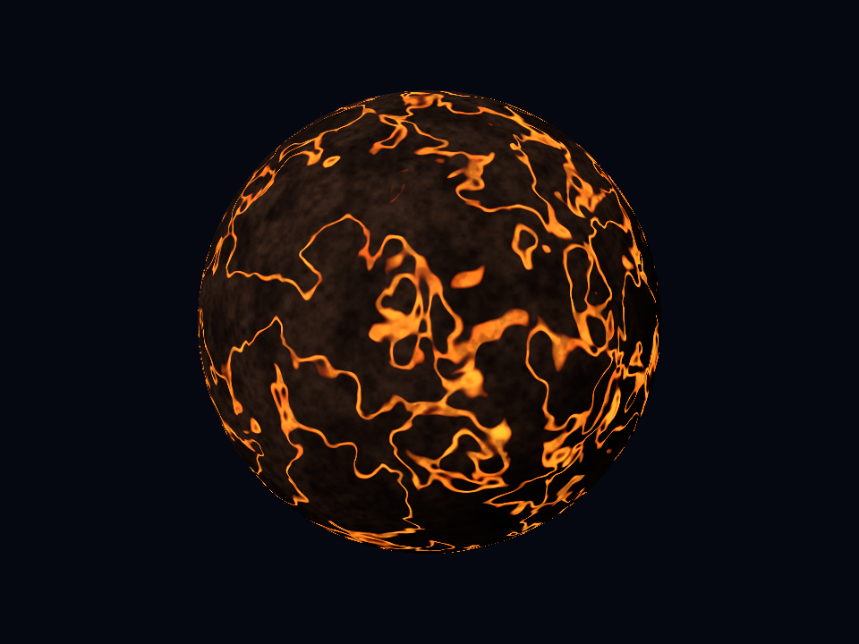
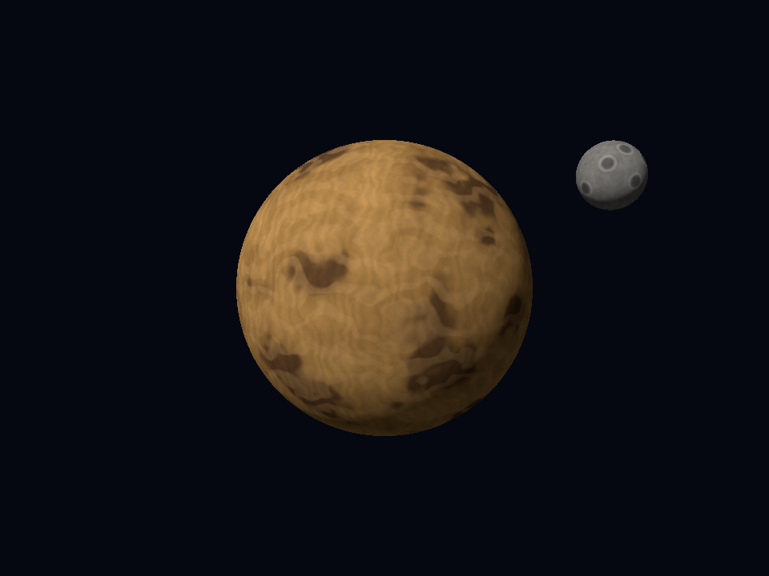
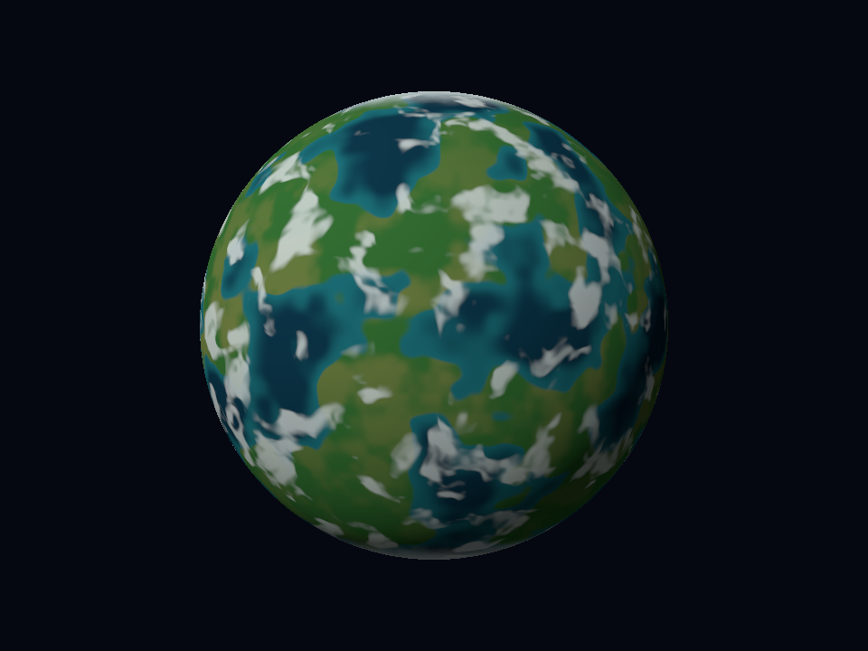

# Tres planetas extra y una luna procedural

**Estado: aprobados visualmente e incluidos en la entrega.** Los tres diseños principales aprobados permanecen disponibles sin cambios de apariencia. Los extras son ilustraciones propias inspiradas en la variedad visual de TRAPPIST-1, no superficies conocidas de esos exoplanetas. La luna tampoco representa una exoluna observada.

## Ejecutar

```sh
cargo run --release --locked -- --volcanic
cargo run --release --locked -- --desert --moon
cargo run --release --locked -- --temperate
```

Vistas estáticas, P captura y Esc sale. `--angle RAD` cambia orientación de superficie; no produce una órbita. `--moon` solo se acepta con `--desert`. Sin el flag se conserva exactamente la misma cámara y el mismo planeta, pero no se dibuja la luna.

## Capas acumulativas

Todos los colores proceden de funciones matemáticas evaluadas por fragmento en `src/extras.rs`. La dirección local se reconstruye desde las UV de la esfera. Se reutilizan el ruido determinista y el campo de tres octavas de `src/procedural.rs`; no hay archivos de textura ni materiales.

| Cuerpo | 1 | 2 | 3 | 4 |
|---|---|---|---|---|
| Volcánico | Granulación basáltica | Cicatrices de costra enfriada | Red de lava emisiva | Fragmentación de emisión y ceniza fina |
| Desértico | Arena ocre de escala amplia | Cuencas oscuras | Estratos curvos | Dunas y grano fino |
| Templado | Variación oceánica azul-verde | Continentes verdes y secos | Hielo polar | Nubes fragmentadas |

`--layers 1..4` selecciona cuántas etapas se aplican. Las mezclas y modulaciones conservan contribuciones anteriores; las máscaras de hielo, costa y nubes son locales, no sustituyen toda la esfera. La luna conserva su shader completo al cambiar las capas del planeta.

### Volcánico



Un dominio 3D deformado por ruido define una cresta alrededor de `F(q)=0.49`. Su anchura varía mediante transiciones suaves; el color de calor mezcla rojo y naranja. La emisión se suma a la roca iluminada, por lo que las grietas siguen visibles en el lado nocturno sin hacer luminosa toda la superficie.

### Desértico



Las cuencas se seleccionan mediante el campo de baja frecuencia. Los estratos utilizan `sin(32p.y + 15F(4.2p+offset))`; las dunas combinan coordenadas oblicuas y otra deformación de ruido. Es relieve aparente por color: no se desplazan vértices ni se cambian normales.

### Templado



La costa utiliza una transición entre los umbrales `0.48` y `0.51` de un campo tridimensional. Sobre el agua se mezclan continentes verdes, con variación más seca; el hielo depende de `|p.y|` con perturbación fina. Un campo deformado independiente produce nubes discontinuas, sin remolino centrado en un océano-ojo.

## Luna: un segundo modelo real

- Esfera UV independiente `uv_sphere(32,64)`, frente a `uv_sphere(64,128)` del planeta.
- Radio artístico `0.22` veces el del planeta. Centro local de la escena `(1.45,0.72,0.35)`; planeta centrado en el origen.
- Segunda llamada real a `draw_model`, con transformación y shader propios, sobre el mismo framebuffer y z-buffer.
- Estadísticas de ambos dibujos sumadas con el acumulador completo `RenderStats`.
- Cráteres sugeridos por color: cuencas oscuras y anillos claros definidos por distancias angulares a ocho centros. No son agujeros geométricos ni mapas muestreados.
- Iluminación direccional compartida con el planeta. No se simulan sombras entre cuerpos, reflejo planetario, eclipses ni órbita dinámica.
- Cámara del desértico ligeramente más alejada para encuadrar el satélite también en formatos verticales. El encuadre no cambia al activar/desactivar la luna.

La implementación permite acreditar separadamente tres diseños planetarios y un satélite modelado; la aplicación de los puntos y el límite de nota corresponde al docente.

## Pruebas y preservación

Las pruebas de nuevas identidades, ruta CLI y luna tienen recibos RED/GREEN locales. Las guardas adicionales cubren capas, continuidad, coordenadas locales, repetibilidad, validación, encuadre horizontal/vertical y equivalencia con dos dibujos explícitos.

El verificador público regenera las referencias anteriores y las nuevas; las capturas previas se mantienen como oráculos sin regenerar sus hashes para aceptar cambios. La apariencia de estos extras y el tamaño de la luna fueron aceptados por Charlie. Esa aprobación no se presenta como validación de simulación física ni pruebas de todas las teclas.
