# Shaders y capas de color

Los tres cuerpos principales usan la misma esfera procedural y el pipeline CPU de `src/renderer/`. El callback del shader recibe UV, posición y normal interpoladas, y devuelve color lineal. El framebuffer se convierte a sRGB para presentarlo o guardarlo como PNG.

Las coordenadas locales se reconstruyen con:

```text
p = (sin(πv) cos(2πu), cos(πv), sin(πv) sin(2πu))
```

Se evalúan campos matemáticos en estas coordenadas; no se leen imágenes. El ruido de valor 3D usa hash determinista e interpolación suave. El campo fractal combina tres octavas con pesos `0.57`, `0.29`, `0.14`.

## Estrella de neutrones — `src/neutron.rs`

| Base azul | Polos | Filamentos | Borde interior |
|---|---|---|---|
| 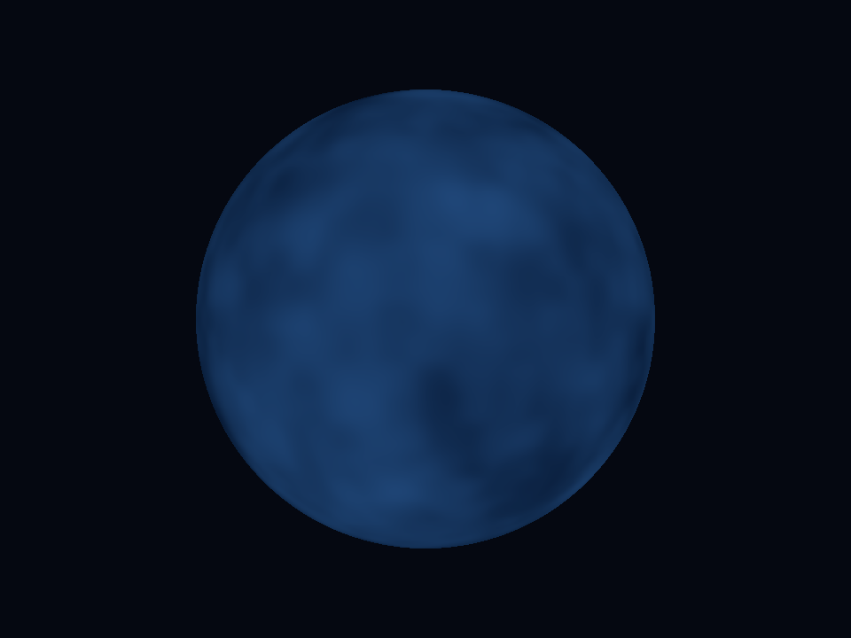 | 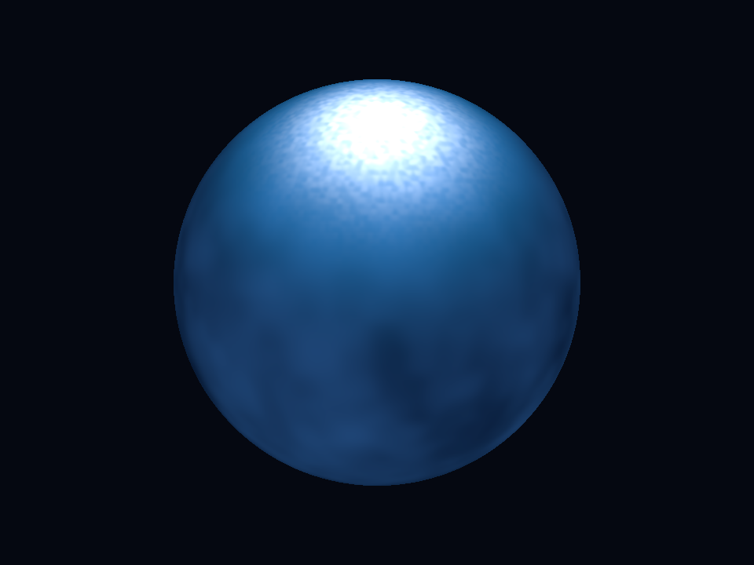 | 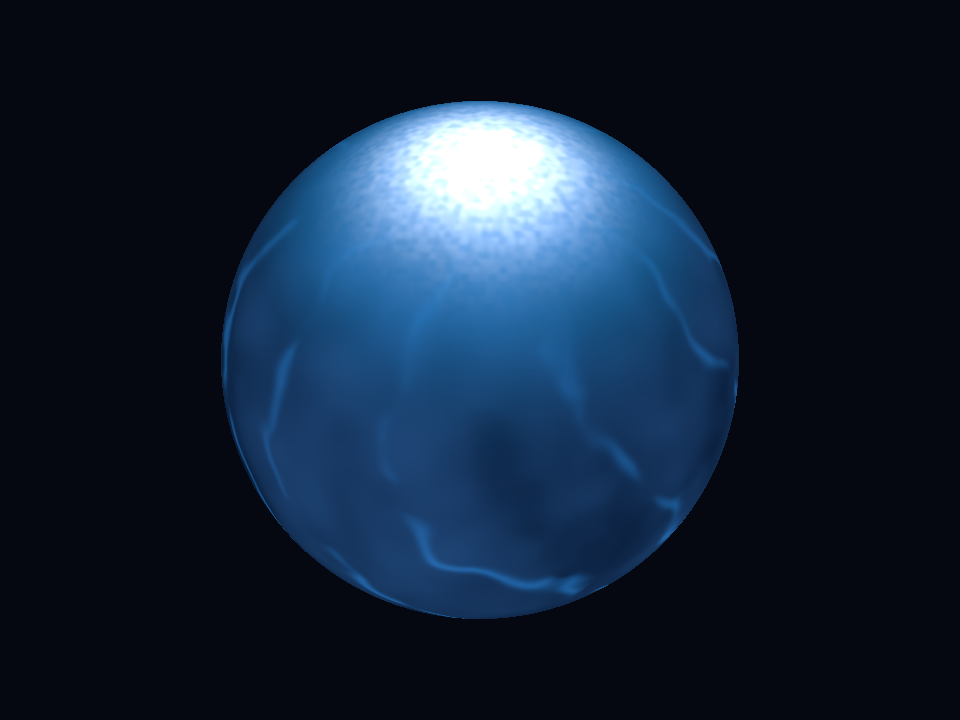 | 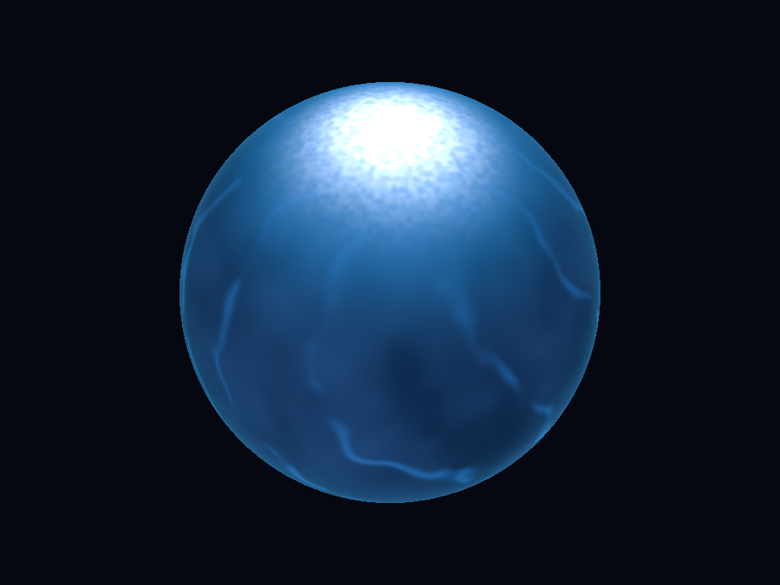 |

1. **Base:** un campo amplio interpola azules oscuros y se modula por un término artístico de oscurecimiento del limbo.
2. **Polos:** con `a=normalize((0.48,0.63,0.61))` y `m=|p·a|`, se suman una falda cian proporcional a `m^8` y un núcleo blanco proporcional a `m^32`, con granulación a escala `45`. El valor absoluto crea dos polos opuestos; la propia esfera puede ocultar uno.
3. **Filamentos:** en la base perpendicular al eje se calculan ángulos `θ,φ`. La fase `10φ + 5sin(2θ) + 6F(p)` forma hebras curvas; ruido adicional las interrumpe y `1-m²` suprime la singularidad angular en los polos.
4. **Borde:** emisión azul interior proporcional a `(1-facing)^5`. Esta ruta no genera píxeles fuera de la esfera.

El modo `--neutron-live` mantiene el shader y modula solo la contribución polar con:

```text
g(t) = clamp(1 - 0.80(0.5 - 0.5cos(2π(t mod 3.6)/3.6)), 0.20, 1.0)
```

Giro artístico: `0.42 rad/s`, calculado con tiempo transcurrido. No se presenta como una escala física ni como una simulación de emisión relativista.

## Mundo rocoso congelado — `src/eyeball.rs`

| Costra | Fracturas | Océano-ojo | Nubes |
|---|---|---|---|
| 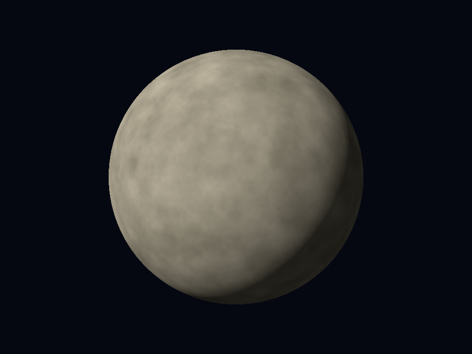 | 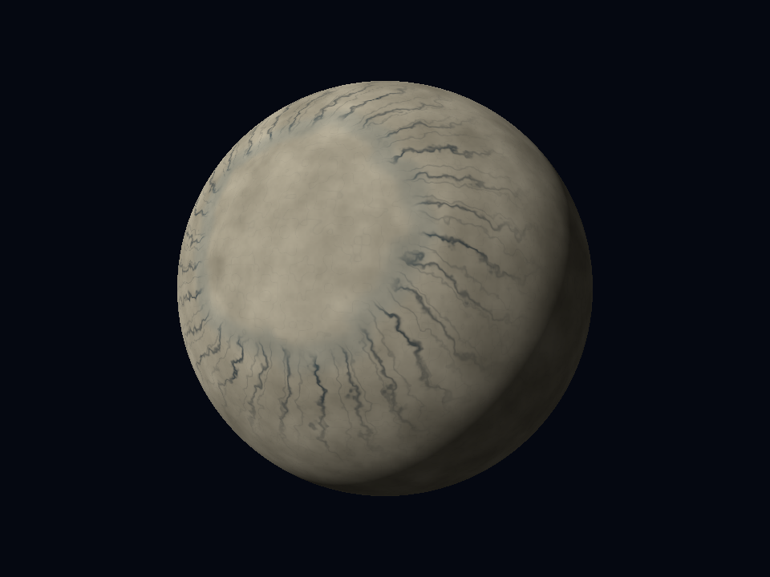 | 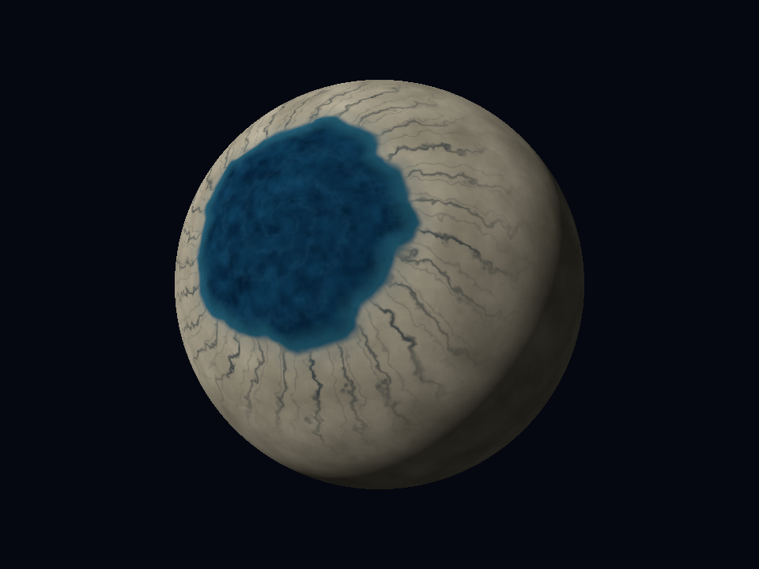 | 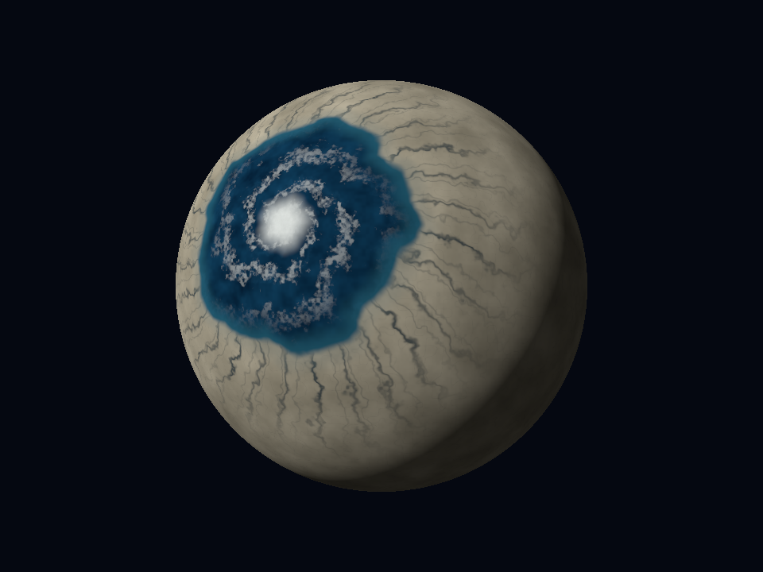 |

1. **Hielo:** campos amplios y finos interpolan beige y gris cálido.
2. **Fracturas:** familias de oscilaciones angulares estrechas se mezclan hacia azul-gris oscuro; una envolvente concentra parte de las grietas alrededor del deshielo.
3. **Océano:** se define un eje `a=normalize((-0.37,0.24,0.90))`, distancia angular `ρ=acos(p·a)` y azimut `φ`. El radio cambia mediante oscilaciones y ruido:

```text
R = 0.49 + 0.028sin(5φ+3w)
         + 0.016(2F(13p+2.1)-1)
         + 0.009sin(13φ+4w)
M = 1-smoothstep(R-0.018, R+0.018, ρ)
```

La máscara `M` mezcla azules de agua y orilla. No se usa `abs(p·a)`: el océano no debe repetirse en el hemisferio opuesto.

4. **Nubes:** una fase de espiral `3φ + 12ln(r+0.12)`, deformada por dos campos de ruido, genera brazos fragmentados con un núcleo claro. La contribución se limita al océano. Los brazos exteriores son translúcidos en la mezcla de color y dejan agua visible.

Las fracturas y las nubes solo sugieren profundidad por color. No hay relieve geométrico. El diseño de LHS 1140 b es artístico, no una superficie observada.

## Gigante gaseoso — `src/gas_v2.rs`

| Masas azules | Corrientes | Filamentos pálidos | Bruma |
|---|---|---|---|
| 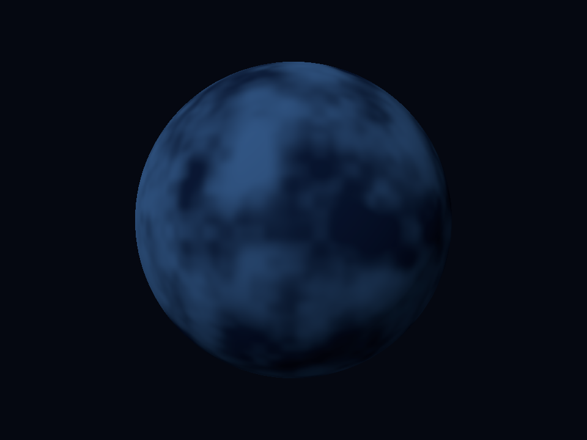 | 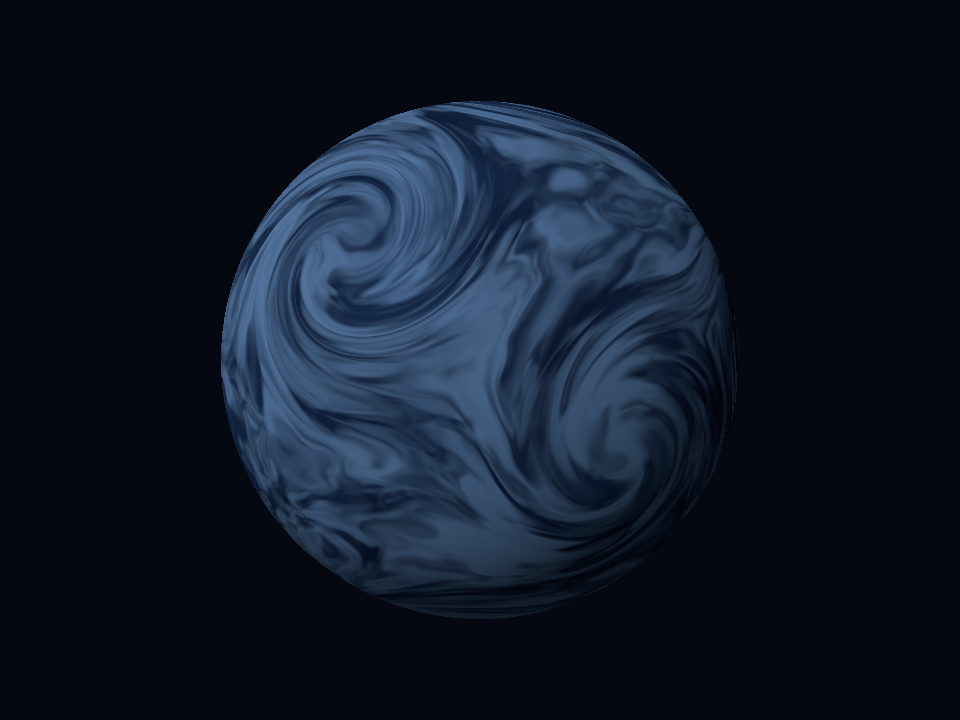 |  | 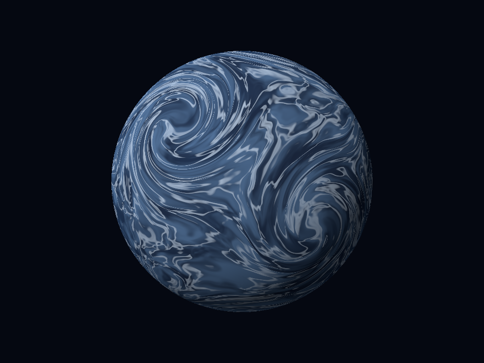 |

1. **Base:** ruido fractal tridimensional mezcla masas de azul profundo, sin franjas regulares de latitud.
2. **Corrientes:** ocho ejes locales remapean las coordenadas mediante giros espaciales. Para cada eje unitario:

```text
w = max(p·a,0)^18
θ = w × intensidad
p' = pcosθ + (a×p)sinθ + a(p·a)(1-cosθ)
```

Después se aplica estiramiento y dos deformaciones vectoriales de dominio. El color turbulento se mezcla al `85%`, conservando contribución de la base en el resultado completo. Esto es un remapeo espacial estático, no una integración temporal de vientos.

3. **Filamentos:** crestas suaves de `F(2.4q+offset)` mezclan azul pálido. Un campo más fino cambia su intensidad. No hay una espiral pegada ni una máscara de tormenta aislada.
4. **Bruma:** mezcla tenue y el limbo interior unen las masas sin borrar las corrientes.

La iluminación de los planetas es `0.075+0.925max(n·l,0)` para el gaseoso, con `l=normalize((-0.65,0.8,1))`; el rocoso utiliza su configuración artística propia. Ninguno se presenta como una simulación atmosférica o un mapa observado del exoplaneta.

## Presentación principal: púlsar — `src/pulsar.rs`

La esfera usa un shader de emisión turbulenta distinto de la versión base conservada. Los arcos externos siguen curvas ilustrativas `r=Lsin²θ`; los haces usan segmentos y perfiles gaussianos proyectados. Se omiten muestras ocultas por la esfera mediante una intersección analítica rayo-esfera y se suma emisión en un buffer lineal.

La corona exterior se calcula con un perfil radial analítico. Se aplica `1-exp(-C)` antes del encoder sRGB para conservar detalle de emisión. No es bloom por convolución ni transporte volumétrico. Las estadísticas de triángulos corresponden solo a la esfera, no al coste total de estos efectos.

En esta ruta, `--layers 1..4` activa etapas de exhibición: superficie, arcos, haces y corona. No se cuentan como cuatro capas extra del requisito académico.
